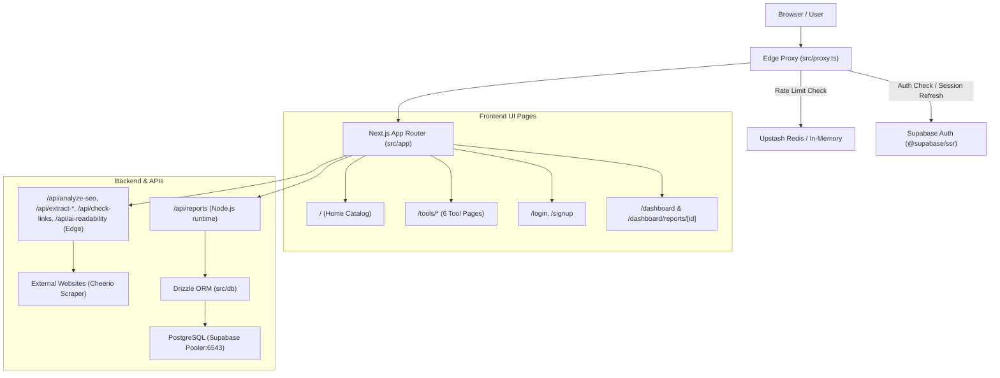

# AI Handoff Specification — SEOSnap (SiteGPTClone)

> **Audience**: Claude Code CLI (DeepSeek V4.1 Flash / OpenRouter) & future engineering partners.  
> **Repository Location**: `D:\SiteGPTClone`  
> **Brand / Live Domain**: SEOSnap (`https://www.seosnap.xyz`, mirror: `https://devtools-lilac-nine.vercel.app`)  
> **Companion documents**: [`DEVELOPMENT_STATUS.md`](DEVELOPMENT_STATUS.md) — verified health and priorities · [`PRODUCT_VISION.md`](PRODUCT_VISION.md) — intent and principles · [`FLAGS_AND_CONCERNS.md`](FLAGS_AND_CONCERNS.md) — open risks, deliberate decisions and known caveats

---

## 1. Executive Summary

SiteGPTClone (rebranded and deployed as **SEOSnap**) is a Next.js 16 micro-SaaS application providing high-speed, free technical SEO and web content analysis tools. It features six distinct scraping and auditing utilities, edge API routes, optional Supabase authentication, Drizzle ORM persistence for user reports, IP rate-limiting via Upstash Redis, and an automated CI pipeline with Vitest and Playwright.

This document serves as the canonical handoff bridge from Gemini Antigravity to Claude Code CLI, providing all recovered architectural decisions, verified runtime facts, gotchas, and prioritized next steps.

---

## 2. Product Vision, Motivation, and Target Users

- **Problem Solved**: Developers, solopreneurs, and content creators need immediate technical SEO audits, heading outlines, and link checks without paying $100+/mo for enterprise platforms or signing up for ad-cluttered spam sites.
- **Vision**: A lightweight, zero-friction developer & marketer utility platform where all tools work immediately without signup, while a free account unlocks persistent report storage in a private dashboard.
- **Target Users**:
  - Independent web developers checking on-page tags before production deployment.
  - Content writers reverse-engineering competitor page outlines and word counts.
  - Marketers and site owners auditing broken links and extracting XML sitemaps.

---

## 3. Product Requirements and Expected User Experience

1. **Unrestricted Public Tool Usage**: Visitors can run any of the 6 tools anonymously without limits other than rate-limiting protection.
2. **Instant Visual Feedback**: Results render immediately upon completion with clear status badges, tag tables, and Google SERP snippet previews.
3. **Report Saving**: Each tool page features a `SaveReportButton`. Unauthenticated users see a gentle prompt to register; authenticated users can save the audit with a single click.
4. **Dashboard Management**: The `/dashboard` route lists all saved reports for the logged-in user with timestamps and a delete option. Clicking a report opens `/dashboard/reports/[id]`, which re-renders the audit as a structured, tool-specific visual breakdown (matching the original tool's output) rather than raw JSON, with the exact stored payload still reachable behind a collapsed "Raw JSON" disclosure.
5. **PDF Export**: The Free SEO Report tool allows downloading a formatted PDF summary directly in the browser via `html2pdf.js` / `jspdf`.

---

## 4. Current Architecture and Directory Map

### Architecture Flow



### Directory Structure

```text
D:\SiteGPTClone\
├── .github\
│   └── workflows\ci.yml        # CI: typecheck, lint, test, build, Playwright E2E
├── drizzle\                    # Drizzle migrations and metadata snapshots
├── public\                     # Static assets (svg icons, logos)
├── src\
│   ├── app\
│   │   ├── api\                # Route Handlers
│   │   │   ├── ai-readability\ # Edge: 14 AI-crawler readability signals + robots.txt AI-token parse
│   │   │   ├── analyze-seo\    # Edge: Cheerio on-page SEO extractor
│   │   │   ├── check-links\    # Edge: Broken link checker with anchor text + redirect chains
│   │   │   ├── extract-content\# Edge: Document heading outline extractor
│   │   │   ├── extract-sitemap\# Edge: robots.txt and XML sitemap parser
│   │   │   ├── free-seo-report\# Edge: High-level metrics for PDF export
│   │   │   ├── health\         # Edge: Public health check endpoint
│   │   │   └── reports\        # Node.js: Authenticated CRUD for saved reports
│   │   ├── dashboard\          # /dashboard list, /dashboard/reports/[id] detail
│   │   │   └── reports\[id]\   # report-views.tsx dispatches on toolName to 6 views
│   │   │                       # report-views.test.tsx — 36 render tests
│   │   ├── login\ signup\      # Auth pages
│   │   ├── tools\              # 6 dedicated tool pages
│   │   │   └── ai-readability\ # page.tsx + layout.tsx + opengraph-image.tsx
│   │   │                       # (each tool\ has layout.tsx for metadata and its own
│   │   │                       #  opengraph-image.tsx, since pages are client components)
│   │   ├── layout.tsx          # Root layout and global theme styles
│   │   ├── opengraph-image.tsx # Site-level OG image (rendered at request time via next/og)
│   │   ├── page.tsx            # Server-rendered tool catalog + search/filter page
│   │   ├── proxy.ts            # Edge Proxy (formerly middleware)
│   │   └── site-chrome.tsx     # Navigation header and footer with auth state
│   ├── components\             # Shared components (SaveReportButton)
│   │   └── tool-extras.tsx     # FaqSection, RelatedTools, ToolSchema (JSON-LD) for tool pages
│   ├── db\                     # Drizzle schema (`users`, `savedReports`) & client
│   ├── lib\                    # Auth wrappers, Supabase client, rate limiting
│   │   ├── __tests__\          # ai-readability.test.ts, rate-limit.test.ts, seo-analyzer.test.ts
│   │   ├── ai-readability.ts   # Pure, unit-tested scoring model (11 weighted checks)
│   │   └── og-image.tsx        # Shared OpenGraph image renderer
│   ├── instrumentation.ts      # Server Sentry instrumentation
│   └── instrumentation-client.ts # Client Sentry instrumentation
├── tests\
│   ├── e2e\tools.spec.ts       # Playwright E2E test suite
│   └── scratch\                # Scratch diagnosis scripts
├── CLAUDE.md                   # Claude Code CLI persistent project configuration
├── drizzle.config.ts           # Drizzle Kit configuration (loads .env.local)
├── eslint.config.mjs           # ESLint flat config
├── next.config.ts              # Next.js standalone build & security headers
├── package.json                # Dependencies and npm scripts
├── playwright.config.ts        # Playwright configuration
├── vitest.config.mts           # Vitest unit test configuration
└── README.md                   # Public repository documentation
```

---

## 5. Implementation Status

| Feature | Status | Notes |
| :--- | :--- | :--- |
| **SEO Analyzer** | Complete | Scrapes title, description, OG tags, Twitter cards, headings, canonical URL, and renders SERP preview. |
| **Free SEO Report** | Complete | Generates technical summary cards and supports client-side PDF export. |
| **Content Extractor** | Complete | Extracts DOM-order headings (H1–H3) and word count. |
| **Sitemap Extractor** | Complete | Queries `robots.txt` and XML sitemaps; handles nested sitemaps. |
| **Broken Link Checker**| Complete | Scrapes `<a href>`, batch-checks HTTP statuses with fallback to GET. *On branch (not yet merged)*: captures anchor text per link and walks redirect chains manually (`redirect: "manual"`, ≤5 hops, single 8s timeout), exposing `anchorTexts`, `redirects`, `redirectCount` and optional `finalUrl`. |
| **AI Readability Checker**| Complete | `/tools/ai-readability` + `/api/ai-readability` (Edge). Reports whether the dedicated AI crawlers (GPTBot, ClaudeBot, PerplexityBot and equivalents) can read a page. Scoring lives in `src/lib/ai-readability.ts` — a pure, unit-tested module with 11 weighted checks totalling 100 points. *This score is our own heuristic, not a Google metric or ranking factor*; the tool page states this prominently. |
| **Auth System** | Complete | Supabase Auth with SSR cookies; abstracted through `src/lib/auth-client.ts`. |
| **Save Report Feature** | Complete | `SaveReportButton` on all 6 tools; saves JSON payload to database. |
| **Dashboard** | Complete | Protected by proxy; lists saved reports and supports deletion. |
| **Saved Report Detail**| Complete | `/dashboard/reports/[id]` dispatches on `toolName` to six per-tool visual views in `report-views.tsx` (SERP preview, score donut, heading outline, URL/status tables), with the raw payload behind a collapsed `<details>`. Covered by 36 render tests. |
| **Rate Limiter** | Complete | 20 req/min sliding window via Upstash; in-memory fallback. |
| **Error Monitoring** | Complete | Optional Sentry setup; inactive if `NEXT_PUBLIC_SENTRY_DSN` is empty. |
| **SiteGPT Conversational Q&A** | Planned / Unknown | Repository name implies potential AI chat over scraped websites. Not yet started. |

---

## 6. Important Source Files, APIs, Data Models, and Integrations

### Critical Code Paths
1. **Edge Proxy**: [`src/proxy.ts`](file:///D:/SiteGPTClone/src/proxy.ts)
   - Runs before all non-static requests.
   - Enforces rate limits on `/api/*` (except `/api/health`).
   - Refreshes Supabase session cookies.
   - Redirects unauthenticated access to `/dashboard` to `/login?next=/dashboard`.
   - Strips trailing slashes and sets caching headers.
2. **Database Schema**: [`src/db/schema.ts`](file:///D:/SiteGPTClone/src/db/schema.ts)
   - `users`: `id` (text, primary key), `email` (text), `name`, `avatarUrl`, timestamps.
   - `savedReports`: `id` (uuid, default random), `userId` (text, unconstrained), `toolName` (text), `reportTitle` (text), `reportData` (jsonb), `createdAt` (timestamp).
   - *Design Note*: `userId` is plain text without a foreign key constraint to enable instant migration to Clerk or alternative auth providers without schema alterations.
3. **Auth Abstraction**:
   - Client: [`src/lib/auth-client.ts`](file:///D:/SiteGPTClone/src/lib/auth-client.ts) (`signInWithEmail`, `signUpWithEmail`, `signOutUser`, `onAuthChange`).
   - Server: [`src/lib/auth.ts`](file:///D:/SiteGPTClone/src/lib/auth.ts) (`getCurrentUserId`, `getCurrentUser`, `getSupabaseServerClient`).
4. **Tool APIs**:
   - All tool scrapers are in [`src/app/api/`](file:///D:/SiteGPTClone/src/app/api/) and declare `export const runtime = "edge"`.
   - [`src/app/api/ai-readability/route.ts`](file:///D:/SiteGPTClone/src/app/api/ai-readability/route.ts) measures 14 page signals with Cheerio and parses `robots.txt` for 12 known AI crawler tokens. It reports **named agents only** — a `User-agent: *` rule is never attributed to specific bots, and an unfetchable `robots.txt` is not treated as a block.
   - Saved report API is in [`src/app/api/reports/route.ts`](file:///D:/SiteGPTClone/src/app/api/reports/route.ts) and uses `export const runtime = "nodejs"` because Drizzle PostgreSQL client requires Node.js sockets.
5. **AI Readability Scoring**: [`src/lib/ai-readability.ts`](file:///D:/SiteGPTClone/src/lib/ai-readability.ts)
   - Pure, unit-tested module (11 weighted checks, 100 points): content in the HTML 20, heading structure 12, structured data 12, title 10, freshness 10, meta description 8, content-to-markup ratio 8, indexable 7, AI crawler access 5, canonical 5, language 3.
   - Weights follow published AI-citation correlation findings (metadata & freshness r=0.68, semantic HTML r=0.65, structured data r=0.63).
   - Thresholds were calibrated against live measurements, not guessed: react.dev (1,045 words genuinely in its HTML) and seosnap.xyz (163 words) initially failed the content-to-markup ratio check because modern frameworks ship large inline script payloads. The ratio floor is now 1% (pass at 5%) and the word pass bar 150. Measured results after calibration: seosnap.xyz 85/good, react.dev 80/good, example.com 47/critical, web.telegram.org 39/critical with 0 words.
6. **Shared Tool-Page Components**: [`src/components/tool-extras.tsx`](file:///D:/SiteGPTClone/src/components/tool-extras.tsx)
   - `FaqSection` (per-tool FAQ rendered with FAQPage JSON-LD), `RelatedTools` (cross-links between tools), and `ToolSchema` (SoftwareApplication JSON-LD with `isAccessibleForFree: true` and a zero-price Offer).
   - No `aggregateRating` is emitted anywhere, since the site has no real ratings and inventing them violates Google's structured-data guidelines.
7. **OpenGraph Imaging**: [`src/lib/og-image.tsx`](file:///D:/SiteGPTClone/src/lib/og-image.tsx) holds the shared renderer; [`src/app/opengraph-image.tsx`](file:///D:/SiteGPTClone/src/app/opengraph-image.tsx) covers the site and each tool route has its own `opengraph-image.tsx`. Generated at request time with `next/og`, not committed as binaries.

---

## 7. Setup, Environment, Development, and Build Instructions

### Prerequisites
- Node.js 20+ (CI uses Node 24).
- Package Manager: `npm`.

### Essential Commands
```bash
# Install dependencies
npm install

# Start development server (must use --webpack flag as configured)
npm run dev

# Run unit tests with Vitest
npm test

# Run type check
npx tsc --noEmit

# Run linter
npm run lint

# Run Playwright E2E tests
npm run test:e2e

# Generate database migrations
npm run db:generate

# Push schema directly to database
npm run db:push

# Production build
npm run build
```

### Environment Configuration (`.env.local`)
Create `.env.local` using the template from `.env.example`:
- `NEXT_PUBLIC_SITE_URL`: Canonical site URL (default: `http://localhost:3000` locally, `https://www.seosnap.xyz` in prod).
- `NEXT_PUBLIC_SUPABASE_URL`: Supabase project URL.
- `NEXT_PUBLIC_SUPABASE_ANON_KEY`: Supabase anonymous public API key.
- `DATABASE_URL`: PostgreSQL connection string (must use the Supabase pooler on port 6543 for serverless).
- `UPSTASH_REDIS_REST_URL`: Upstash Redis REST URL (optional; fallback to in-memory if unset).
- `UPSTASH_REDIS_REST_TOKEN`: Upstash Redis REST token (optional).
- `NEXT_PUBLIC_SENTRY_DSN`: Sentry DSN (optional; disabled if unset).

---

## 8. Technical Decisions and Rationale

1. **Next.js 16 App Router with `--webpack`**:
   `next.config.ts` uses webpack instead of default Turbopack to ensure compatibility with `html2pdf.js`, `jspdf`, and custom canvas utilities during builds.
2. **Cheerio on Edge Runtime**:
   Instead of launching heavy Puppeteer/Playwright instances in serverless functions (costly and slow), tools use Cheerio with browser-like headers. This achieves sub-second execution times and handles 95%+ of public web pages.
3. **Decoupled Auth Architecture**:
   Components never call `@supabase/supabase-js` directly. All auth flows pass through `src/lib/auth-client.ts` or `src/lib/auth.ts`. This was deliberately chosen to allow an effortless future migration to Clerk.
4. **Loose Schema Constraints**:
   `savedReports.userId` is stored as an unconstrained text string rather than a Supabase UUID foreign key, accommodating Clerk user IDs (`user_...`) or any third-party auth ID.
5. **In-Memory Rate Limit Fallback**:
   To prevent local development friction and maintain high availability during Redis downtime, the rate limiter falls back to an in-memory token bucket if Upstash credentials are missing.
6. **Server-Rendering Client Components for Discoverability**:
   The homepage was a `"use client"` component that returned `null` until a `useEffect` ran (`if (!mounted) return null`), so the served HTML was an 11,988-byte shell with no h1, no h2 and no tool catalog. Bing, GPTBot, PerplexityBot and ClaudeBot never run JavaScript, so the page did not exist for them. It is now server-rendered (54,291 bytes with an h1, h2, all six tool cards and a canonical); filtering moved to URL params (`?q=`, `?cat=`) that resolve on the server, so category chips are real links and search is a plain GET form — both work without JavaScript. Note that Googlebot and Bingbot *do* render JavaScript in a second pass, which is why a site can rank well in search and still be invisible to the AI assistants.
   Related: per-route `metadata` now lives in a `layout.tsx` inside each tool route folder, because all the tool pages are `"use client"` and Next.js only reads metadata exports from server files. Before this, all six pages shared one identical title and description. Each route now has a unique title, description and canonical.
7. **Defensive Saved-Report Rendering**:
   `savedReports.reportData` is a `jsonb` column, so Drizzle types it as `unknown` and stored rows may predate the current API response shape. Rather than cast, `report-views.tsx` narrows every field through small helpers (`asRecord`, `str`, `num`, `list`) and degrades to an empty state when a field is missing or mistyped. Any field added to a tool's API response must be read the same way. The views are server components — no client state — so the detail page ships no extra JavaScript, and the untruncated payload stays reachable behind a `<details>` element for fields the structured views don't surface.

---

## 9. Bugs, Failed Approaches, Workarounds, and Known Limitations

1. ~~**Scratch Files Breaking ESLint**~~ — **RESOLVED 2026-10-20**:
   Files in `tests/scratch/*.cjs` (`db-check.cjs`, `db-probe.cjs`, `db-tables.cjs`) use `require()`, which caused ESLint's flat config to report 6 `@typescript-eslint/no-require-imports` errors.
   *Fix applied*: `"tests/scratch/**"` added to `globalIgnores` in `eslint.config.mjs`; `npm run lint` now exits 0. `tests/scratch/` is also listed in `.gitignore`, so those files were never tracked — the fix was purely about making them invisible to ESLint.
2. **Supabase Direct Connection on Port 5432 vs Pooler Port 6543**:
   Direct PostgreSQL connections to port 5432 can fail in serverless or IPv6-restricted environments. Always use the Supabase transaction/session pooler on port `6543` with `prepare: false` in `postgres.js`.
3. **Vitest `__dirname` Native Config Warning**:
   Vitest logs a non-fatal warning about `__dirname` in `vitest.config.mts:13:25`.
4. **Bot Challenges on Heavy WAF Sites**:
   Cheerio cannot execute client-side JavaScript. If a target site strictly requires JavaScript rendering (e.g. Single Page Apps without SSR) or enforces Cloudflare Captchas, the scraper returns an HTTP 403 or empty DOM.
5. **`/dashboard` Returns 200 with a Client-Side Redirect**:
   Unauthenticated visitors to `/dashboard` receive an HTTP 200 and a **client-side** redirect to `/login?next=/dashboard`, rather than a server 3xx. `src/proxy.ts` is documented as handling this at the edge, and an edge redirect would show as a 3xx, so the guard may not be firing as documented. The outcome is correct (you do land on `/login?next=/dashboard`) and the page is `noindex`, but a brief flash of the dashboard shell occurs. **Not yet investigated.**
6. **Opaque-Redirect Fallback Is Unexercised** (branch):
   In the new link checker, if the runtime returns an opaque redirect (status 0, no readable `Location`), the code falls back to a `redirect: "follow"` request so `ok`/`status` stay correct and the chain is reported as empty. Next's dev edge runtime exposes `Location` for `redirect: "manual"`, so this path has **not** been exercised. Vercel's production isolates may differ — it needs verification on production after deploy.
7. **`@next/swc-win32-x64-msvc` Fails to Load on the Windows Dev Machine**:
   `npm run build` logs `Attempted to load @next/swc-win32-x64-msvc ... is not a valid Win32 application` several times before falling back to the WASM compiler. The build still exits 0. Environmental; not a code defect.
8. **Homepage Fails the Freshness Check — Deliberately Not Fixed**:
   The homepage carries no date signal, so it fails the AI Readability *freshness* check. This is a deliberate decision, not an oversight: adding a `dateModified` purely to raise a score would fabricate a freshness claim the site does not have — exactly the behaviour this tool criticises in competitors.

---

## 10. Security Requirements and Secret Management

- **Zero Secrets in Repository**: Never commit API keys, service role keys, or database passwords. All secrets belong in `.env.local` or host environment variables.
- **Client vs. Server Separation**: Only variables prefixed with `NEXT_PUBLIC_` are exposed to the browser (`NEXT_PUBLIC_SUPABASE_URL`, `NEXT_PUBLIC_SUPABASE_ANON_KEY`, `NEXT_PUBLIC_SITE_URL`).
- **Database Safety**: Never run raw destructive SQL statements (`DROP TABLE`, `TRUNCATE`) without explicit confirmation.
- **Payload Sanitization**: `src/app/api/reports/route.ts` enforces a maximum payload size of 500 KB (`MAX_REPORT_BYTES = 500_000`) and limits report titles to 300 characters to prevent database bloat.

---

## 11. Current Project State & Git Working Tree

- **Live Site**: `https://www.seosnap.xyz`, deployed on **Vercel**. The sitemap lists **7 URLs** (homepage + 6 tools). Git integration is now connected: `main` is the production branch and merges auto-deploy. *This was not true before 2026-11-20* — production was manually deployed and had drifted about a month behind `main`. It is fixed now.
- **Tests**: **106 tests across 4 files** (a month ago this was 7 tests across 2 files). The four files are `src/lib/__tests__/ai-readability.test.ts`, `src/lib/__tests__/rate-limit.test.ts`, `src/lib/__tests__/seo-analyzer.test.ts`, and `src/app/dashboard/reports/[id]/report-views.test.tsx`.
- **Branch**: `feat/link-context-and-homepage-schema` (link anchor text + redirect chains, and homepage JSON-LD). Committed as `09e0e26` and pushed. **Implemented and verified, NOT yet merged.**
- **Recent Git Commits** (on `main`):
  - `a7b1e74`: Merge PR #6 — feat/ai-readability-check
  - `8aa57af`: feat(ai-readability): add an AI crawler readability checker
  - `ead0473`: feat(ai-readability): add scoring model and check definitions
  - `d679042`: Merge PR #5 — feat/discoverability-phase-0
  - `a8e7bd0`: feat(seo): phase 0 discoverability — server-rendered home, per-page metadata, OG images, FAQ and app schema
- **Working Tree**: Clean apart from three intentionally untracked files: `CLAUDE.md`, `.claudeignore` and `docs/marketing-strategy.html`. The last is the growth plan — deliberately kept out of version control at the owner's request, so never `git add` it. Its "5 tools / 6 pages" figures predate the AI Readability Checker and are a point-in-time snapshot, not current state.

---

## 12. Immediate Next Steps (Ordered by Priority)

> Tasks 1 and 2 from the previous snapshot (ESLint scratch-file ignores, and the structured saved
> report UI) were completed on 2026-10-20. Since then, Phase 0 discoverability and the AI Readability
> Checker shipped. The remaining work, in priority order, is below.
>
> **Do this first, once the current branch merges:** scan a page containing a redirecting link
> against **production** and confirm the `redirects` array is populated. The link checker's
> opaque-redirect fallback is unexercised — Next's dev edge runtime exposes `Location` for
> `redirect: "manual"`, but Vercel's production isolates are a different runtime, so this is the one
> code path that has been reasoned about rather than observed. Worst case if it differs is empty
> chains, never a misreported status. See `FLAGS_AND_CONCERNS.md` §1.

1. **Task 1: Implement Dashboard PDF/CSV Export**
   - File: `src/app/dashboard/reports/[id]/page.tsx`
   - Goal: Allow users to download saved audits in PDF or CSV formats. A CSV shape must be chosen per tool, since the six saved payloads differ structurally.
2. **Task 2: Add Unit Tests for the Edge Scraper Logic Itself**
   - Goal: Test Cheerio parsing against static HTML fixture strings to ensure tag extraction resilience. The rendering layer and the scoring model are tested (`report-views.test.tsx`, `ai-readability.test.ts`), but the scrapers themselves — the `route.ts` handlers — are not.
3. **Task 3: Phase 2 of the Growth Strategy — Expand the Indexable Surface**
   - Goal: Grow from 7 pages toward 25–30, one *working* tool or data-backed page at a time. This is explicitly **NOT** a programmatic page farm: Google's scaled-content-abuse policy applies "no matter how it's created", enforcement is silent, and one documented case went from 22,000 indexed pages to 1 overnight.
4. **Task 4: Phase 3 Distribution**
   - Goal: Show HN, r/InternetIsBeautiful, r/SideProject. **Explicitly avoid** Product Hunt (featured rate fell from 35.9% in 2022 to 3.2% in 2026; median 1 vote) and the SEO subreddits (r/SEO removes any post containing a link; r/bigseo's rules ban "free tools" by name).
5. **Task 5: Monitor Search Console for Indexing and First Impressions**
   - Submission is done — all 7 URLs were submitted for indexing and the sitemap resubmitted on 2026-11-21. The remaining work is monitoring, not submission.
   - Expect near-zero organic traffic for the first 3 months; that is normal and not a signal of failure. Realistic timings: pages index within days, first long-tail impressions and clicks appear within 1–3 months, and durable rankings only after 6–12 months.
   - Track **leading indicators, not traffic**: pages indexed, impressions appearing for the new per-page titles, and first long-tail clicks. For context on why patience is required — only 1.74% of newly published pages reach the top 10 within a year, and 72.9% of top-10 pages are over three years old.

---

## 13. Longer-Term Roadmap

- **SiteGPT Conversational Integration**: If desired, ingest extracted sitemaps into vector embeddings for a conversational site chatbot widget.
- **Batch Scraping & Domain Monitoring**: Scheduled automated audits with email alerts when broken links appear.
- **Clerk Authentication Switch**: Complete the transition from Supabase Auth to Clerk using the established abstraction layer.

---

## 14. Unknowns and Questions Requiring User Clarification

1. `UNKNOWN`: Is conversational Q&A / chat over scraped sites (SiteGPT feature) planned for a future release, or should the product focus exclusively on SEO auditing?
2. `UNKNOWN`: Is there a target date for the Clerk migration, or should Supabase Auth remain the active provider?
3. `ANSWERED 2026-10-20`: The saved report viewer should render a per-tool visual breakdown resembling the original tool's output, with the raw JSON retained behind a collapsible disclosure. Implemented in `report-views.tsx`.
4. `ANSWERED 2026-11-21`: Should the indexable surface be expanded via programmatic page generation? **No.** Growth is one *working* tool or data-backed page at a time (Phase 2), because Google's scaled-content-abuse policy applies "no matter how it's created" and enforcement is silent — one documented case went from 22,000 indexed pages to 1 overnight.
