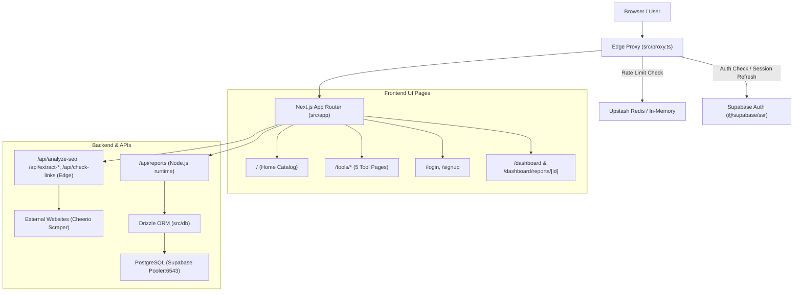

# AI Handoff Specification — SEOSnap (SiteGPTClone)

> **Audience**: Claude Code CLI (DeepSeek V4.1 Flash / OpenRouter) & future engineering partners.  
> **Repository Location**: `D:\SiteGPTClone`  
> **Brand / Live Domain**: SEOSnap (`https://www.seosnap.xyz`, mirror: `https://devtools-lilac-nine.vercel.app`)

---

## 1. Executive Summary

SiteGPTClone (rebranded and deployed as **SEOSnap**) is a Next.js 16 micro-SaaS application providing high-speed, free technical SEO and web content analysis tools. It features five distinct scraping and auditing utilities, edge API routes, optional Supabase authentication, Drizzle ORM persistence for user reports, IP rate-limiting via Upstash Redis, and an automated CI pipeline with Vitest and Playwright.

This document serves as the canonical handoff bridge from Gemini Antigravity to Claude Code CLI, providing all recovered architectural decisions, verified runtime facts, gotchas, and prioritized next steps.

---

## 2. Product Vision, Motivation, and Target Users

- **Problem Solved**: Developers, solopreneurs, and content creators need immediate technical SEO audits, heading outlines, and link checks without paying $100+/mo for enterprise platforms or signing up for ad-cluttered spam sites.
- **Vision**: A lightweight, zero-friction developer & marketer utility platform where all tools work immediately without signup, while a free account unlocks persistent report storage in a private dashboard.
- **Target Users**:
  - Independent web developers checking on-page tags before production deployment.
  - Content writers reverse-engineering competitor page outlines and word counts.
  - Marketers and site owners auditing broken links and extracting XML sitemaps.

---

## 3. Product Requirements and Expected User Experience

1. **Unrestricted Public Tool Usage**: Visitors can run any of the 5 tools anonymously without limits other than rate-limiting protection.
2. **Instant Visual Feedback**: Results render immediately upon completion with clear status badges, tag tables, and Google SERP snippet previews.
3. **Report Saving**: Each tool page features a `SaveReportButton`. Unauthenticated users see a gentle prompt to register; authenticated users can save the audit with a single click.
4. **Dashboard Management**: The `/dashboard` route lists all saved reports for the logged-in user with timestamps and a delete option. Clicking a report opens `/dashboard/reports/[id]`, which re-renders the audit as a structured, tool-specific visual breakdown (matching the original tool's output) rather than raw JSON, with the exact stored payload still reachable behind a collapsed "Raw JSON" disclosure.
5. **PDF Export**: The Free SEO Report tool allows downloading a formatted PDF summary directly in the browser via `html2pdf.js` / `jspdf`.

---

## 4. Current Architecture and Directory Map

### Architecture Flow



### Directory Structure

```text
D:\SiteGPTClone\
├── .github\
│   └── workflows\ci.yml        # CI: typecheck, lint, test, build, Playwright E2E
├── drizzle\                    # Drizzle migrations and metadata snapshots
├── public\                     # Static assets (svg icons, logos)
├── src\
│   ├── app\
│   │   ├── api\                # Route Handlers
│   │   │   ├── analyze-seo\    # Edge: Cheerio on-page SEO extractor
│   │   │   ├── check-links\    # Edge: Concurrent broken link checker
│   │   │   ├── extract-content\# Edge: Document heading outline extractor
│   │   │   ├── extract-sitemap\# Edge: robots.txt and XML sitemap parser
│   │   │   ├── free-seo-report\# Edge: High-level metrics for PDF export
│   │   │   ├── health\         # Edge: Public health check endpoint
│   │   │   └── reports\        # Node.js: Authenticated CRUD for saved reports
│   │   ├── dashboard\          # /dashboard list, /dashboard/reports/[id] detail
│   │   │   └── reports\[id]\   # report-views.tsx dispatches on toolName to 5 views
│   │   │                       # report-views.test.tsx — 36 render tests
│   │   ├── login\ signup\      # Auth pages
│   │   ├── tools\              # 5 dedicated tool pages
│   │   ├── layout.tsx          # Root layout and global theme styles
│   │   ├── page.tsx            # Main tool catalog and search page
│   │   ├── proxy.ts            # Edge Proxy (formerly middleware)
│   │   └── site-chrome.tsx     # Navigation header and footer with auth state
│   ├── components\             # Shared components (SaveReportButton)
│   ├── db\                     # Drizzle schema (`users`, `savedReports`) & client
│   ├── lib\                    # Auth wrappers, Supabase client, rate limiting
│   ├── instrumentation.ts      # Server Sentry instrumentation
│   └── instrumentation-client.ts # Client Sentry instrumentation
├── tests\
│   ├── e2e\tools.spec.ts       # Playwright E2E test suite
│   └── scratch\                # Scratch diagnosis scripts
├── CLAUDE.md                   # Claude Code CLI persistent project configuration
├── drizzle.config.ts           # Drizzle Kit configuration (loads .env.local)
├── eslint.config.mjs           # ESLint flat config
├── next.config.ts              # Next.js standalone build & security headers
├── package.json                # Dependencies and npm scripts
├── playwright.config.ts        # Playwright configuration
├── vitest.config.mts           # Vitest unit test configuration
└── README.md                   # Public repository documentation
```

---

## 5. Implementation Status

| Feature | Status | Notes |
| :--- | :--- | :--- |
| **SEO Analyzer** | Complete | Scrapes title, description, OG tags, Twitter cards, headings, canonical URL, and renders SERP preview. |
| **Free SEO Report** | Complete | Generates technical summary cards and supports client-side PDF export. |
| **Content Extractor** | Complete | Extracts DOM-order headings (H1–H3) and word count. |
| **Sitemap Extractor** | Complete | Queries `robots.txt` and XML sitemaps; handles nested sitemaps. |
| **Broken Link Checker**| Complete | Scrapes `<a href>`, batch-checks HTTP statuses with fallback to GET. |
| **Auth System** | Complete | Supabase Auth with SSR cookies; abstracted through `src/lib/auth-client.ts`. |
| **Save Report Feature** | Complete | `SaveReportButton` on all 5 tools; saves JSON payload to database. |
| **Dashboard** | Complete | Protected by proxy; lists saved reports and supports deletion. |
| **Saved Report Detail**| Complete | `/dashboard/reports/[id]` dispatches on `toolName` to five per-tool visual views in `report-views.tsx` (SERP preview, score donut, heading outline, URL/status tables), with the raw payload behind a collapsed `<details>`. Covered by 36 render tests. |
| **Rate Limiter** | Complete | 20 req/min sliding window via Upstash; in-memory fallback. |
| **Error Monitoring** | Complete | Optional Sentry setup; inactive if `NEXT_PUBLIC_SENTRY_DSN` is empty. |
| **SiteGPT Conversational Q&A** | Planned / Unknown | Repository name implies potential AI chat over scraped websites. Not yet started. |

---

## 6. Important Source Files, APIs, Data Models, and Integrations

### Critical Code Paths
1. **Edge Proxy**: [`src/proxy.ts`](file:///D:/SiteGPTClone/src/proxy.ts)
   - Runs before all non-static requests.
   - Enforces rate limits on `/api/*` (except `/api/health`).
   - Refreshes Supabase session cookies.
   - Redirects unauthenticated access to `/dashboard` to `/login?next=/dashboard`.
   - Strips trailing slashes and sets caching headers.
2. **Database Schema**: [`src/db/schema.ts`](file:///D:/SiteGPTClone/src/db/schema.ts)
   - `users`: `id` (text, primary key), `email` (text), `name`, `avatarUrl`, timestamps.
   - `savedReports`: `id` (uuid, default random), `userId` (text, unconstrained), `toolName` (text), `reportTitle` (text), `reportData` (jsonb), `createdAt` (timestamp).
   - *Design Note*: `userId` is plain text without a foreign key constraint to enable instant migration to Clerk or alternative auth providers without schema alterations.
3. **Auth Abstraction**:
   - Client: [`src/lib/auth-client.ts`](file:///D:/SiteGPTClone/src/lib/auth-client.ts) (`signInWithEmail`, `signUpWithEmail`, `signOutUser`, `onAuthChange`).
   - Server: [`src/lib/auth.ts`](file:///D:/SiteGPTClone/src/lib/auth.ts) (`getCurrentUserId`, `getCurrentUser`, `getSupabaseServerClient`).
4. **Tool APIs**:
   - All tool scrapers are in [`src/app/api/`](file:///D:/SiteGPTClone/src/app/api/) and declare `export const runtime = "edge"`.
   - Saved report API is in [`src/app/api/reports/route.ts`](file:///D:/SiteGPTClone/src/app/api/reports/route.ts) and uses `export const runtime = "nodejs"` because Drizzle PostgreSQL client requires Node.js sockets.

---

## 7. Setup, Environment, Development, and Build Instructions

### Prerequisites
- Node.js 20+ (CI uses Node 24).
- Package Manager: `npm`.

### Essential Commands
```bash
# Install dependencies
npm install

# Start development server (must use --webpack flag as configured)
npm run dev

# Run unit tests with Vitest
npm test

# Run type check
npx tsc --noEmit

# Run linter
npm run lint

# Run Playwright E2E tests
npm run test:e2e

# Generate database migrations
npm run db:generate

# Push schema directly to database
npm run db:push

# Production build
npm run build
```

### Environment Configuration (`.env.local`)
Create `.env.local` using the template from `.env.example`:
- `NEXT_PUBLIC_SITE_URL`: Canonical site URL (default: `http://localhost:3000` locally, `https://www.seosnap.xyz` in prod).
- `NEXT_PUBLIC_SUPABASE_URL`: Supabase project URL.
- `NEXT_PUBLIC_SUPABASE_ANON_KEY`: Supabase anonymous public API key.
- `DATABASE_URL`: PostgreSQL connection string (must use the Supabase pooler on port 6543 for serverless).
- `UPSTASH_REDIS_REST_URL`: Upstash Redis REST URL (optional; fallback to in-memory if unset).
- `UPSTASH_REDIS_REST_TOKEN`: Upstash Redis REST token (optional).
- `NEXT_PUBLIC_SENTRY_DSN`: Sentry DSN (optional; disabled if unset).

---

## 8. Technical Decisions and Rationale

1. **Next.js 16 App Router with `--webpack`**:
   `next.config.ts` uses webpack instead of default Turbopack to ensure compatibility with `html2pdf.js`, `jspdf`, and custom canvas utilities during builds.
2. **Cheerio on Edge Runtime**:
   Instead of launching heavy Puppeteer/Playwright instances in serverless functions (costly and slow), tools use Cheerio with browser-like headers. This achieves sub-second execution times and handles 95%+ of public web pages.
3. **Decoupled Auth Architecture**:
   Components never call `@supabase/supabase-js` directly. All auth flows pass through `src/lib/auth-client.ts` or `src/lib/auth.ts`. This was deliberately chosen to allow an effortless future migration to Clerk.
4. **Loose Schema Constraints**:
   `savedReports.userId` is stored as an unconstrained text string rather than a Supabase UUID foreign key, accommodating Clerk user IDs (`user_...`) or any third-party auth ID.
5. **In-Memory Rate Limit Fallback**:
   To prevent local development friction and maintain high availability during Redis downtime, the rate limiter falls back to an in-memory token bucket if Upstash credentials are missing.
6. **Defensive Saved-Report Rendering**:
   `savedReports.reportData` is a `jsonb` column, so Drizzle types it as `unknown` and stored rows may predate the current API response shape. Rather than cast, `report-views.tsx` narrows every field through small helpers (`asRecord`, `str`, `num`, `list`) and degrades to an empty state when a field is missing or mistyped. Any field added to a tool's API response must be read the same way. The views are server components — no client state — so the detail page ships no extra JavaScript, and the untruncated payload stays reachable behind a `<details>` element for fields the structured views don't surface.

---

## 9. Bugs, Failed Approaches, Workarounds, and Known Limitations

1. ~~**Scratch Files Breaking ESLint**~~ — **RESOLVED 2026-10-20**:
   Files in `tests/scratch/*.cjs` (`db-check.cjs`, `db-probe.cjs`, `db-tables.cjs`) use `require()`, which caused ESLint's flat config to report 6 `@typescript-eslint/no-require-imports` errors.
   *Fix applied*: `"tests/scratch/**"` added to `globalIgnores` in `eslint.config.mjs`; `npm run lint` now exits 0. `tests/scratch/` is also listed in `.gitignore`, so those files were never tracked — the fix was purely about making them invisible to ESLint.
2. **Supabase Direct Connection on Port 5432 vs Pooler Port 6543**:
   Direct PostgreSQL connections to port 5432 can fail in serverless or IPv6-restricted environments. Always use the Supabase transaction/session pooler on port `6543` with `prepare: false` in `postgres.js`.
3. **Vitest `__dirname` Native Config Warning**:
   Vitest logs a non-fatal warning about `__dirname` in `vitest.config.mts:13:25`.
4. **Bot Challenges on Heavy WAF Sites**:
   Cheerio cannot execute client-side JavaScript. If a target site strictly requires JavaScript rendering (e.g. Single Page Apps without SSR) or enforces Cloudflare Captchas, the scraper returns an HTTP 403 or empty DOM.

---

## 10. Security Requirements and Secret Management

- **Zero Secrets in Repository**: Never commit API keys, service role keys, or database passwords. All secrets belong in `.env.local` or host environment variables.
- **Client vs. Server Separation**: Only variables prefixed with `NEXT_PUBLIC_` are exposed to the browser (`NEXT_PUBLIC_SUPABASE_URL`, `NEXT_PUBLIC_SUPABASE_ANON_KEY`, `NEXT_PUBLIC_SITE_URL`).
- **Database Safety**: Never run raw destructive SQL statements (`DROP TABLE`, `TRUNCATE`) without explicit confirmation.
- **Payload Sanitization**: `src/app/api/reports/route.ts` enforces a maximum payload size of 500 KB (`MAX_REPORT_BYTES = 500_000`) and limits report titles to 300 characters to prevent database bloat.

---

## 11. Current Project State & Git Working Tree

- **Branch**: `main` (up to date with `origin/main`).
- **Recent Git Commits**:
  - `674be6e`: feat(reports): render saved reports with per-tool visual views
  - `3d0170a`: chore(lint): ignore tests/scratch/** in ESLint flat config
  - `a713e4c`: ci: add build step and Playwright E2E job
  - `462604c`: chore(env): document all env vars in .env.example
  - `e3d76ef`: feat(monitoring): add optional Sentry error tracking
- **Working Tree**: Clean apart from `CLAUDE.md` and `.claudeignore`, which remain untracked by choice. The `docs/` handoff files were added in the commit documenting the 2026-10-20 work.

---

## 12. Immediate Next Steps (Ordered by Priority)

> Tasks 1 and 2 from the previous snapshot (ESLint scratch-file ignores, and the structured saved
> report UI) were completed on 2026-10-20. The remaining work is renumbered below.

1. **Task 1: Implement Dashboard PDF/CSV Export**
   - File: `src/app/dashboard/reports/[id]/page.tsx`
   - Goal: Allow users to download saved audits in PDF or CSV formats. A CSV shape must be chosen per tool, since the five saved payloads differ structurally.
2. **Task 2: Add Unit Tests for API Scraper Logic**
   - File: `src/lib/__tests__/scraper.test.ts`
   - Goal: Test Cheerio parsing against static HTML fixture strings to ensure tag extraction resilience. The rendering layer is now covered by 36 tests in `report-views.test.tsx`, but the scrapers themselves remain untested.
3. **Task 3: Resolve the Vitest `__dirname` Config Warning**
   - File: `vitest.config.mts:13`
   - Goal: Replace `__dirname` with `import.meta.dirname` to silence the non-fatal warning and prepare for Vite's `configLoader: 'native'` default.

---

## 13. Longer-Term Roadmap

- **SiteGPT Conversational Integration**: If desired, ingest extracted sitemaps into vector embeddings for a conversational site chatbot widget.
- **Batch Scraping & Domain Monitoring**: Scheduled automated audits with email alerts when broken links appear.
- **Clerk Authentication Switch**: Complete the transition from Supabase Auth to Clerk using the established abstraction layer.

---

## 14. Unknowns and Questions Requiring User Clarification

1. `UNKNOWN`: Is conversational Q&A / chat over scraped sites (SiteGPT feature) planned for a future release, or should the product focus exclusively on SEO auditing?
2. `UNKNOWN`: Is there a target date for the Clerk migration, or should Supabase Auth remain the active provider?
3. `ANSWERED 2026-10-20`: The saved report viewer should render a per-tool visual breakdown resembling the original tool's output, with the raw JSON retained behind a collapsible disclosure. Implemented in `report-views.tsx`.
