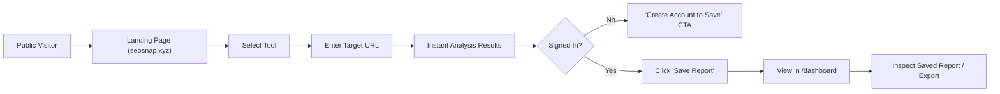

# Product Vision — SEOSnap (SiteGPTClone)

> **Context**: This document captures the product intent, user experience goals, and architectural principles of the project. It serves as permanent guidance for Claude Code CLI and human contributors.

---

## 1. Problem Statement & Mission

### The Problem
Auditing technical on-page SEO, scraping heading structures from competitor pages, validating sitemaps, and scanning for broken links usually requires either:
1. Bloated, expensive enterprise SEO platforms (e.g., Ahrefs, Semrush, Screaming Frog).
2. Ad-ridden web tools gated behind forced email signups, paywalls, or slow browser extensions.

### The Mission
**SEOSnap** provides a lightning-fast, high-utility micro-SaaS suite of technical SEO and content inspection tools.
- **Instant utility**: Users get immediate audit results without registration.
- **Optional persistence**: Creating a free account allows users to save and revisit audit reports in a personal dashboard.
- **Global edge speed**: API endpoints leverage edge execution where possible for low latency.

---

## 2. Target Users & Core Use Cases

| User Persona | Key Needs | Primary Tools Used |
| :--- | :--- | :--- |
| **Solopreneurs & Indie Hackers** | Quick pre-launch sanity check of meta tags, OpenGraph previews, and robots.txt. | SEO Analyzer, Free SEO Report |
| **Content Marketers & Writers** | Reverse-engineering competitor content outlines, heading hierarchies, and word counts. | Content Extractor |
| **Webmasters & Developers** | Identifying 404s and redirect chains across a landing page; extracting full URL lists from sitemaps. | Broken Link Checker, Sitemap Extractor |
| **Agencies & Freelancers** | Generating quick, exportable PDF audit summaries for client calls without paid subscriptions. | Free SEO Report (PDF export) |

---

## 3. Core Product Principles

1. **Zero-Barrier Utility First**:
   All 5 core tools must remain functional without requiring authentication. Never force login to view results.
2. **Value-Add Authentication**:
   Authentication exists solely to provide persistence: saving reports, organizing audits, and accessing user dashboards.
3. **Speed & Edge Execution**:
   Scrapers and metadata extractors run on lightweight edge/serverless handlers with aggressive timeouts (5–10s) and browser-like headers to bypass standard Cloudflare/WAF bot challenges safely.
4. **Resilient Vendor Abstraction**:
   Auth and Database integrations must remain strictly decoupled via application wrappers (e.g., `src/lib/auth-client.ts`, `src/lib/auth.ts`, unconstrained text `userId` in Drizzle schema) so changing auth providers (e.g., migrating from Supabase to Clerk) touches fewer than three files.
5. **Defense in Depth**:
   Public endpoints are protected by IP-based rate limiting (Upstash Redis sliding window with in-memory fallback), preventing denial-of-service or scraping abuse.

---

## 4. Intended User Journey

---

## 5. Scope: Current State vs. Future Ambitions

### Current Scope (Verified in Codebase)
- **5 Core Tools**:
  1. `SEO Analyzer` (`/tools/seo-analyzer`): Metadata, OpenGraph, Twitter cards, headings, Google SERP preview.
  2. `Free SEO Report` (`/tools/free-seo-report`): High-level technical audit summary with direct client-side PDF export via `html2pdf.js`/`jspdf`.
  3. `Content Extractor` (`/tools/content-extractor`): DOM-order heading outline (H1–H3) and body word count.
  4. `Sitemap Extractor` (`/tools/sitemap-extractor`): Crawls `robots.txt` and XML sitemaps to dump all public URLs.
  5. `Broken Link Checker` (`/tools/broken-link-checker`): Concurrent batch validation of `<a href>` links with HTTP status indicators.
- **Authentication**: Supabase Auth integration via SSR cookies (`/login`, `/signup`, `/dashboard`).
- **Persistence**: Saved reports stored in PostgreSQL via Drizzle ORM (`saved_reports` table).
- **Security & Proxy**: Next.js 16 Edge proxy (`src/proxy.ts`) managing rate limits, session keep-alives, and dashboard access guards.
- **Observability**: Optional Sentry error tracking (`src/instrumentation.ts`).

### Future Ambitions & Hypotheses
- **SiteGPT Conversational Features**:
  *Note on Repository Name*: The repository is titled `SiteGPTClone`, suggesting an initial concept or future phase involving AI-powered website chatbots, vector indexing of scraped pages, or conversational Q&A over crawled content. However, the current verified implementation is strictly the **SEOSnap** SEO tool suite.
  *Status*: `UNKNOWN` / Pending user confirmation whether SiteGPT chat functionality is planned for a later milestone.
- **Rich Saved Report Viewer**:
  Currently, `/dashboard/reports/[id]` renders saved audit JSON in a raw `<pre>` tag. The planned vision is a rich, formatted view matching the tool's original UI.
- **Export from Dashboard**:
  Exporting previously saved reports to PDF or CSV directly from the dashboard.
- **Clerk Auth Migration**:
  The database schema and auth clients are explicitly documented and prepared for a seamless transition from Supabase Auth to Clerk if desired.

---

## 6. Explicit Decisions vs. Open Questions

### Explicit Architectural Decisions
- **Next.js 16 App Router with Webpack**: Scripts explicitly use `--webpack` (`next dev --webpack`, `next build --webpack`).
- **Loose Schema Constraints**: The `saved_reports.userId` column uses `text('user_id')` without foreign key constraints, specifically allowing UUIDs (Supabase) or string IDs (Clerk `user_...`).
- **In-Memory Rate Limiting Fallback**: If Upstash credentials are unset or unreachable, the proxy falls back to an in-memory token bucket to prevent developer friction and avoid breaking production during outages.

### Unresolved Product Questions
1. Is conversational Q&A / AI chat over scraped websites (SiteGPT feature) still in the roadmap, or has the product permanently pivoted to the SEOSnap micro-SaaS tool suite?
2. When will the transition from Supabase Auth to Clerk occur, or should Supabase remain the default?
3. What monetization or tiering model (if any) is planned for saved reports or batch runs?
